# Audit UI/UX professionnel — Novembre 2026

> Périmètre : **toute la plateforme**, côté **membre** et côté **admin**, en **desktop (1440×900)** et **mobile (iPhone 13, 390×844)**.
> Méthode : application lancée en local (Next.js dev + PostgreSQL + Redis, données de démo : 1 admin, 1 membre actif, 6 prospects, 8 signaux), **≈160 captures** de 50+ écrans, tests automatisés **axe-core (WCAG 2.1 A/AA)**, mesure des zones tactiles et des tailles de texte, puis relecture du code source (`fichier:ligne`).
> Captures : [`docs/audits/ui-ux-2026-11/`](./ui-ux-2026-11/). Les issues GitHub associées portent le label `ui-audit-2026-11` (épique #318, issues #319 → #341).

---

## 1. Synthèse

| Dimension | Note | Commentaire |
|---|---|---|
| Fondations visuelles | **7/10** | Palette navy sobre, Geist, cartes propres. Mais couleurs hors design system (173 usages `blue/purple/emerald`), micro-textes 9–11 px partout. |
| Navigation membre | **4/10** | Bottom-nav mobile à 10 entrées défilantes et tronquées, libellés différents desktop/mobile, tour guidé qui réapparaît à chaque page. |
| Navigation admin | **4/10** | Barre « Outils super-admin » répétée en tête de chaque onglet, onglets morts (Modération), onglet qui plante (Revenus), titre mobile figé. |
| Cohérence éditoriale | **4/10** | Tu/vous mélangés (160 « vous » / 43 « tu »), enums bruts (`PAYMENT_PENDING`, `SUPER_ADMIN`), accents manquants, franglais. |
| États (vide / erreur / chargement) | **5/10** | Doubles états vides, erreurs sans « Réessayer », graphiques vides au lieu d'un état vide, messages contradictoires. |
| Accessibilité | **5/10** | Contraste 1.97:1 sur les titres de section, 162 textes `text-[9-11px]`, boutons icônes sans nom, selects/dates sans label. |
| Responsive | **6/10** | Pas de débordement horizontal global (bon point), mais en-têtes qui se compriment mal, cartes qui débordent, tableaux coupés. |

**Note globale : 5/10** — base solide (Base UI, tokens, composants EmptyState, command palette), mais une accumulation de problèmes de **finition, de cohérence et quelques bugs bloquants** qui donnent une impression « pas finie » à un produit payant.

### Top 6 à corriger cette semaine
1. 🔴 Tour de bienvenue jamais mémorisé → réapparaît sur **chaque page**, et **deux tours empilés** sur mobile (#319).
2. 🔴 Onglet admin **Revenus plante** (`Intl.NumberFormat` avec la devise `"F CFA"`) (#320).
3. 🔴 Barre **« Outils super-admin »** (Purge cache…) au-dessus de **chaque** onglet admin — la moitié de l'écran mobile (#322).
4. 🔴 **Centre de vérification contradictoire** : « Compte entièrement validé 100 % » + KYC/Broker « Non soumis » (#323).
5. 🟠 **Bottom-nav membre** : 10 entrées qui défilent, la dernière coupée, « Onboarding » pour un membre validé (#325).
6. 🟠 **Enums bruts et textes non traduits** côté admin (#329).

---

## 2. Constats détaillés

Légende : 🔴 bloquant / bug · 🟠 majeur · 🟡 mineur — **M** = membre, **A** = admin, **D** = desktop, **Mo** = mobile.

### 🔴 UX-01 (#319) — Tour guidé jamais mémorisé, empilé et mal ancré (M · D+Mo)
- `src/app/(dashboard)/dashboard/welcome-guide.tsx:11` lit `nba:welcome-guide` mais **ne l'écrit jamais** (pas de `onDestroyed`/`setItem`). Le composant est monté dans le layout (`src/app/(dashboard)/layout.tsx:84`) → le tour **revient à chaque navigation**.
- Sur mobile, l'étape 1 cible `#signals` dans la sidebar **masquée** : popover flottant sans ancre ; la guide « premier trade » s'affiche **en même temps** (2 popovers superposés).
- Copie trompeuse : « Chaque signal est analysé et **noté par la communauté** » — fonctionnalité inexistante.
- Boutons du popover : libellés alignés à droite dans des boutons pleine largeur.
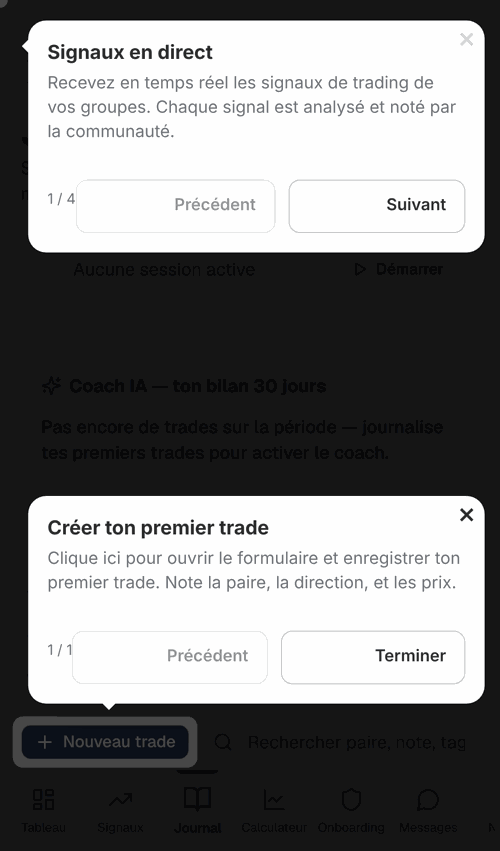

### 🔴 UX-02 (#320) — Onglet Revenus : écran d'erreur (A · D+Mo)
- `RevenueTab.tsx:53` → `new Intl.NumberFormat("fr-FR", { style: "currency", currency })` avec `currency = "F CFA"` (seed `scripts/seed.ts:141`) ⇒ `RangeError: Invalid currency code`. Toute l'interface admin bascule sur « Une erreur est survenue ».
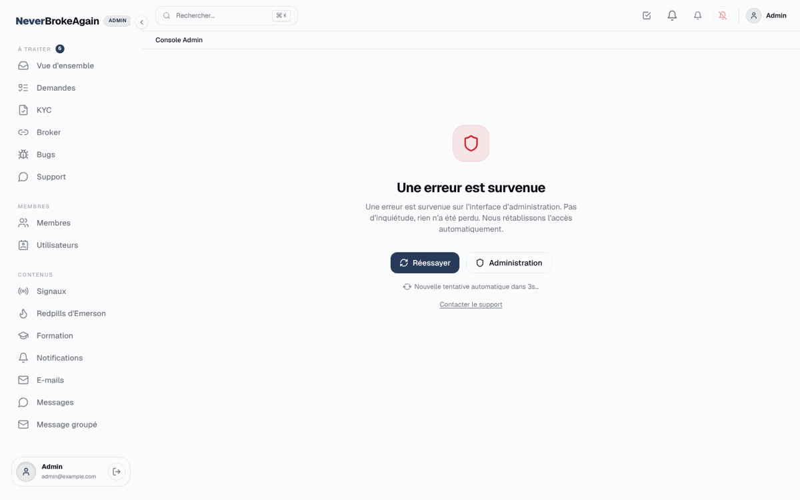

### 🔴 UX-03 (#321) — Onglets et liens morts (A)
- `ModerationTab` importé (`admin/page.tsx:29`) mais **jamais rendu** : `/admin?tab=moderation` (lien de la sidebar « Sécurité ») affiche une page blanche.
- « Control Room » dans la sidebar redirige vers `?tab=dashboard` (doublon).
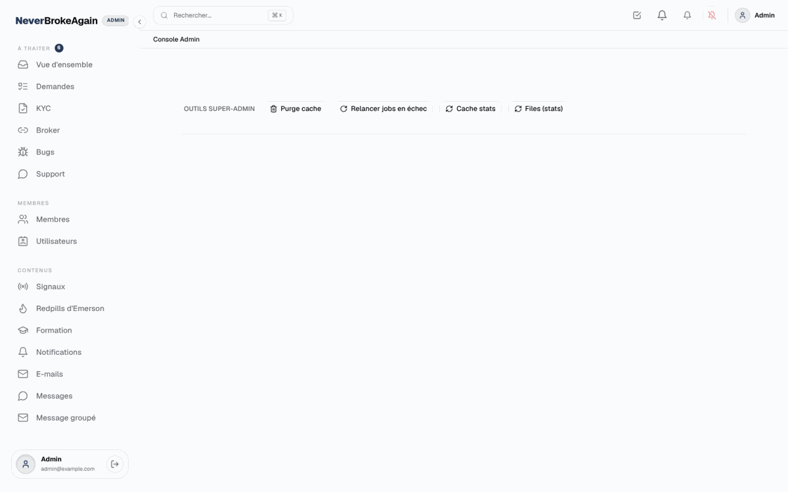

### 🔴 UX-04 (#322) — « Outils super-admin » sur tous les onglets (A · D+Mo)
- `admin/page.tsx:476` rend `<AdminTools />` **avant** chaque module (Demandes, Membres, Signaux, Paramètres…). Sur mobile : ~50 % du premier écran, au-dessus du titre. Actions techniques (Purge cache, Relancer jobs) à 1 clic de l'opérateur KYC.
- Sur mobile, la rangée de chips « Vue d'ensemble / Demandes / KYC / Broker » s'affiche aussi sur Membres, Utilisateurs, Signaux (mauvais contexte).
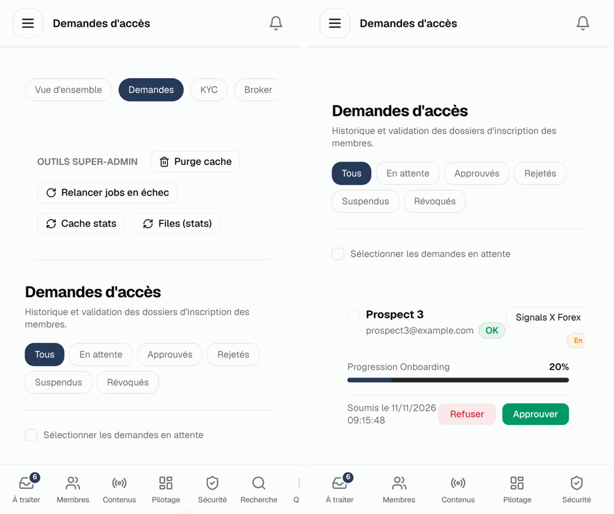

### 🔴 UX-05 (#323) — Centre de vérification contradictoire (M)
- `verification/page.tsx:104` : « Compte Entièrement Validé · 100 % » dès que `status === "ACTIVE"`, alors que les cartes KYC et Broker affichent « Non soumis » juste en dessous.
- Titres dupliqués : « 1. Pièce d'identité (KYC) » puis « Vérification d'identité » dans la même carte.
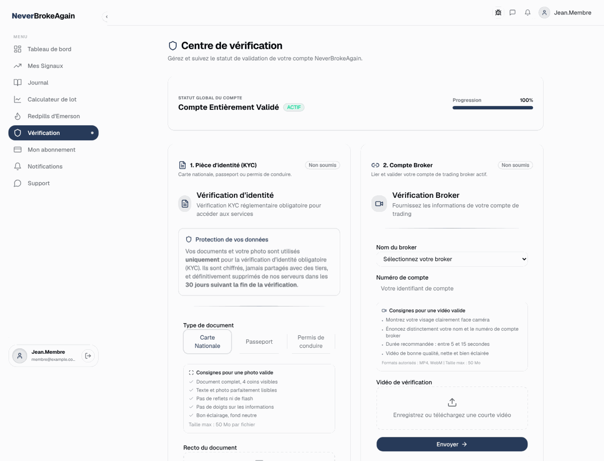

### 🟠 UX-06 (#324) — CSP : styles inline et WebSocket bloqués (M+A)
- `src/middleware.ts:47` : `style-src 'self' 'nonce-…' 'unsafe-inline'` — en présence d'un nonce, `'unsafe-inline'` est **ignoré** : les attributs `style=""` rendus côté serveur sont bloqués (centaines d'erreurs console par page). Risque : barres de progression, safe-area de la bottom-nav (`mobile-bottom-nav.tsx`), graphiques mal dimensionnés au premier rendu.
- `connect-src 'self' https://api.resend.com` bloque `ws://localhost:3001` en dev → indicateur « Connexion… » permanent sur la page Signaux. À vérifier en prod (`wss://` sur un autre port/hôte = bloqué aussi).

### 🟠 UX-07 (#325) — Bottom-nav membre surchargée (M · Mo)
- `src/config/navigation.ts:51-134` : **10 entrées** (Tableau, Signaux, Journal, Calculateur, Onboarding, Messages, Notifs, Offre, Profil) en `overflow-x-auto`, la dernière visible est coupée (« N… »).
- Libellés incohérents avec le desktop : « Onboarding » vs « Vérification », « Offre » vs « Mon abonnement », « Messages » absent de la sidebar desktop, « Redpills » absent du mobile.
- Logo mobile « Never BrokeAgain » (espace parasite) vs « NeverBrokeAgain » desktop (`mobile-menu.tsx:66`).
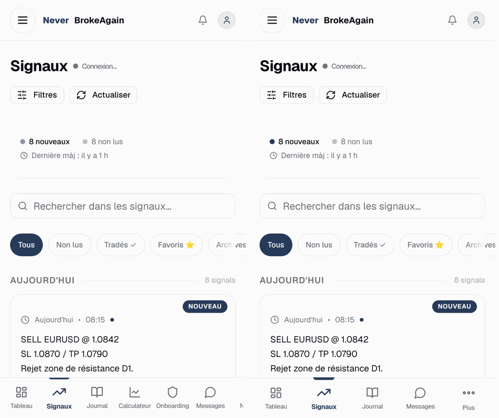

### 🟠 UX-08 (#326) — Navigation mobile admin (A · Mo)
- Bottom-nav admin : 7 entrées, la 7ᵉ coupée (« Q… »).
- Titre de l'en-tête mobile figé à « Tableau de bord » sur À traiter, Audit, Messagerie groupée, Anti-fraude, Redpills (`mobile-page-title.tsx` : tables `ADMIN_TABS`/`ADMIN_PATHS` incomplètes).
- En-tête « Messages » : bouton « Modération » coupé hors écran ; « Hors ligne » sur 2 lignes.
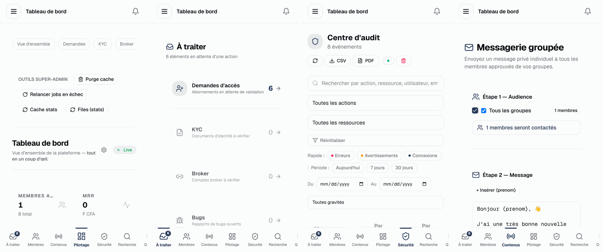
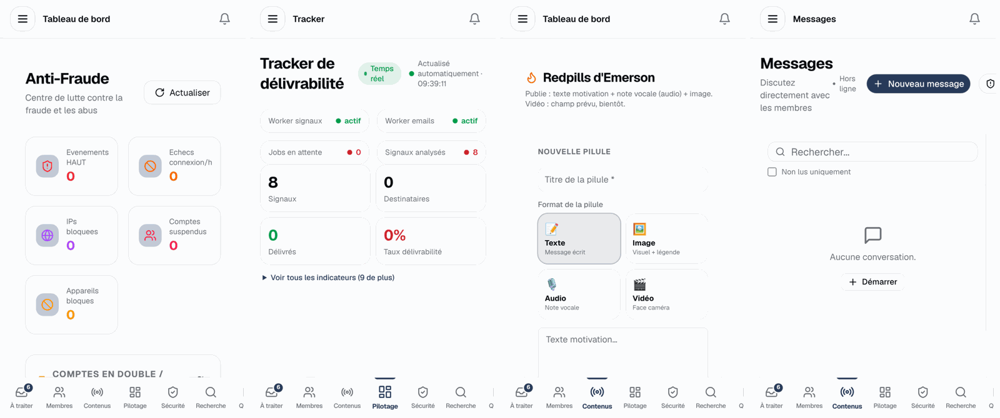

### 🟠 UX-09 (#327) — Architecture de l'information admin (A · D)
- La page d'atterrissage `/admin` (Tableau de bord) est rangée dans la 4ᵉ section « Pilotage », **sous la ligne de flottaison** de la sidebar.
- Doublon « Membres » / « Utilisateurs » (le second s'intitule « Gestion des membres »).
- Fil d'Ariane figé sur « Console Admin » pour tous les onglets ; absent sur la moitié des pages.
- 3 écrans techniques se recouvrent : Cache & Services, Files BullMQ, Mode développeur + « Files (stats) » dans la barre d'outils.

### 🟠 UX-10 (#328) — En-tête : icônes ambiguës (M+A · D)
- Admin : case cochée, **deux cloches**, cloche barrée rouge, sans libellé ni tooltip. Membre : icône « bug » en premier, avant messages et notifications.

### 🟠 UX-11 (#329) — Enums bruts, franglais, accents manquants (A+M)
- `ACTIVE`, `PAYMENT_PENDING`, `KYC_PENDING`, `REGISTERED`, `MEMBER`, `SUPER_ADMIN` affichés tels quels (Membres, Utilisateurs, Profil membre, panneaux `user/signal/broker-panel-content.tsx`).
- Anti-fraude : « Evenements », « Echecs », « IPs bloquees », « EXECUTER », « SEVERITE », badges « PO » (P0 ?) — `FraudTab.tsx`, `security/fraud/page.tsx`.
- DLQ : onglets `PENDING / REPLAYED / ABANDONED`, « Aucune entree pending » ; Cache : « unreachable », « DOWN ».
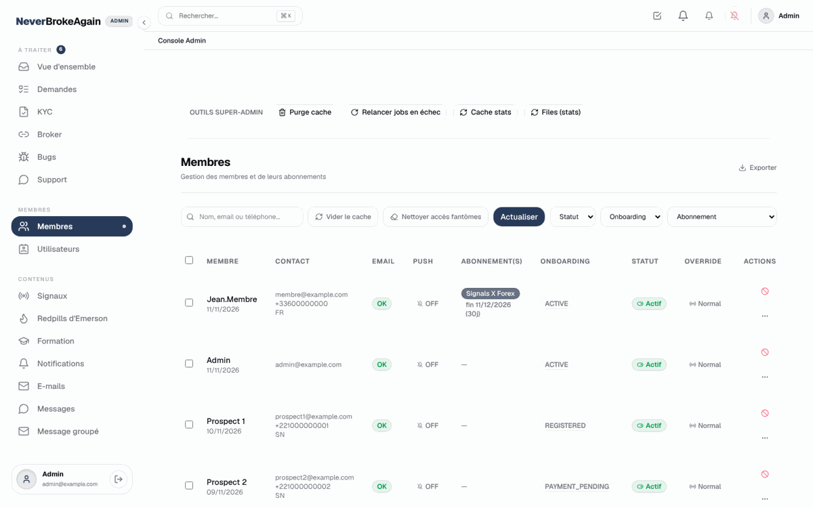
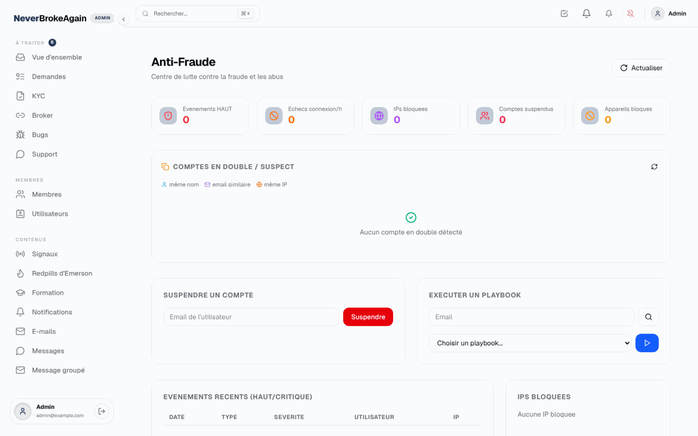

### 🟠 UX-12 (#330) — Ton et vocabulaire incohérents (M+A)
- 160 formulations au **vous** contre 43 au **tu**, souvent sur la même page (Tableau de bord « ton activité », Abonnement « Gérez votre accès », Support « Envoie-nous »).
- Même fonctionnalité, noms différents : « Redpills d'Emerson » (menu) / « Pilule du jour » (page) ; « Vérification » / « Onboarding » / « Centre de vérification » ; « Abonnement » / « Offre » / « Mon abonnement » ; « Coaching » (menu) / « Journaux de trading » (page).

### 🟠 UX-13 (#331) — Monnaies et formats incohérents (M+A)
- Tableau de bord : `+0 €` (`dashboard/page.tsx:60`) ; abonnement et MRR : `0 F CFA` ; calculateur : solde en `$`, risque en `€` (`lot-calculator.tsx:77,105`).
- Dates `mm/dd/yyyy` (format US) dans les filtres d'audit ; `+0` signé pour zéro.

### 🟠 UX-14 (#332) — Carte signal membre peu lisible (M · D+Mo)
- Texte brut (SELL EURUSD @ 1.0842 / SL… / TP…) sans structure : pas de badge direction coloré, paire, entrée/SL/TP alignés, ni R:R.
- Badge « NOUVEAU » sur **tous** les signaux (8/8), cartes de 190 px de haut pour 3 lignes, lignes de 1 100 px en desktop, lien « Cliquez pour voir le détail ».
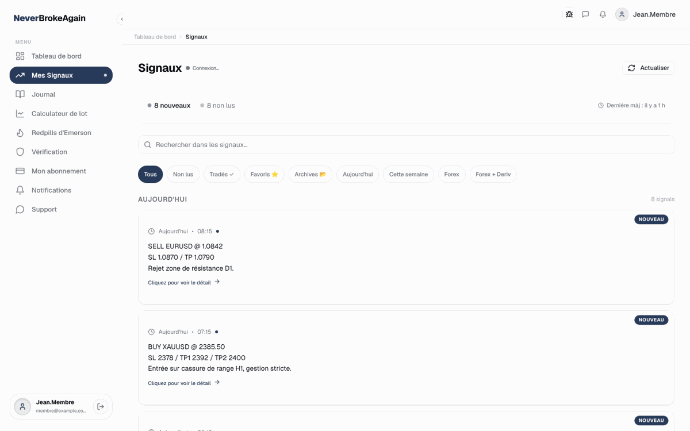

### 🟠 UX-15 (#333) — Couleurs sémantiques et hors système (A+M)
- Zéros colorés en rouge/vert/orange sans signification (Tracker : « 0 Bounces » rouge, « 0 % taux de bounce » vert ; Anti-fraude : tous les compteurs à 0 en rouge/violet/orange ; Analytics « 0 % KYC vérifiés » en vert).
- 173 classes `blue-*/purple-*/emerald-*` en dur (bouton bleu `bg-blue-600` de la page fraude) au lieu des tokens `primary/success/destructive/warning`.
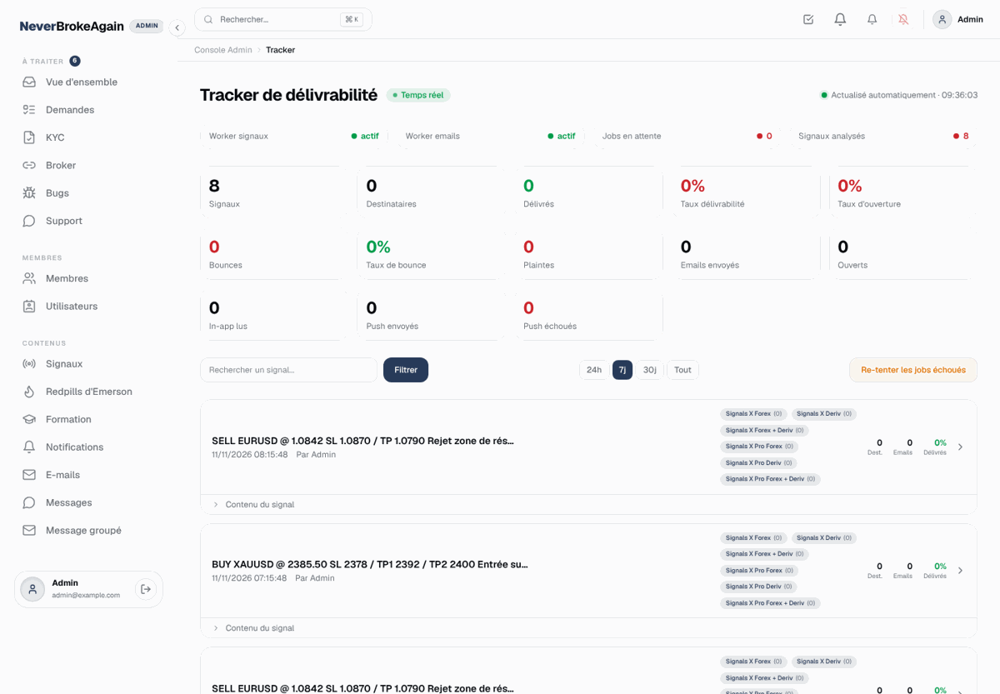

### 🟠 UX-16 (#334) — Gabarits de page incohérents (M+A · D)
- Largeur de contenu variable d'une page à l'autre : pleine largeur (Tableau de bord, Signaux, Journal), centrée 672 px (Profil, Notifications, Support, Abonnement), 960 px (Vérification), étroite (Coaching).
- En-têtes de page : avec icône (Audit, Messagerie groupée, Redpills, Développeur) ou sans ; fil d'Ariane présent sur 40 % des pages ; action principale tantôt à droite, tantôt sous le titre.
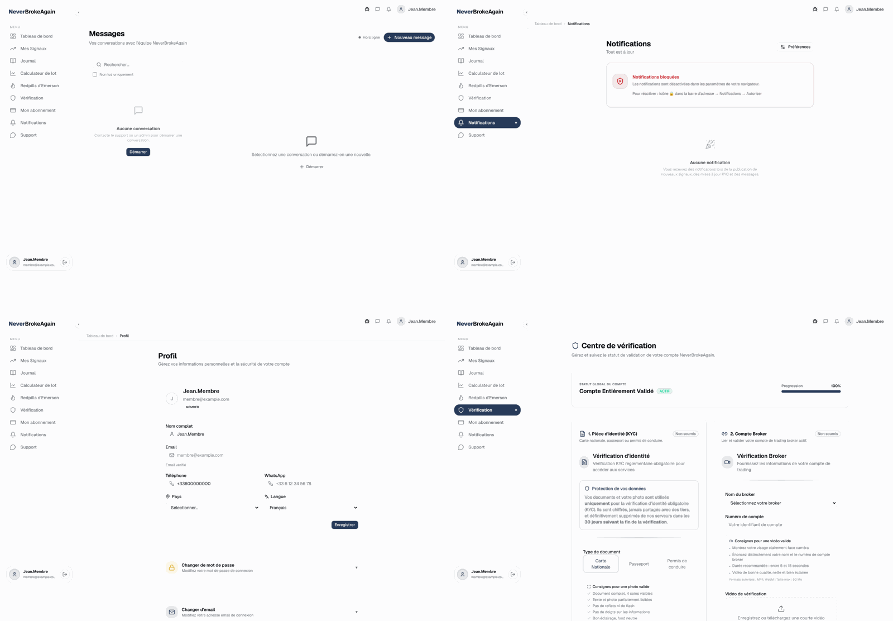

### 🟠 UX-17 (#335) — États vides, erreurs et messages contradictoires (M+A)
- Messages (M et A) : **deux** états vides côte à côte avec deux boutons « Démarrer ».
- Support admin : « Impossible de charger les tickets » sans bouton « Réessayer », sous un en-tête « 0 tickets ouverts ».
- Tracker membre : graphiques vides à 0 au lieu d'un état vide.
- Redpills : « Tu es à jour » + « Aucune pilule pour le moment ».
- Notifications : grande carte rouge « Notifications bloquées » + « Tout est à jour ».
- Support : « Brouillon sauvegardé à 09:33 » alors que rien n'a été saisi.
- Notifications admin : CTA « Rédiger une notification » dans l'état vide alors que le formulaire est juste au-dessus.
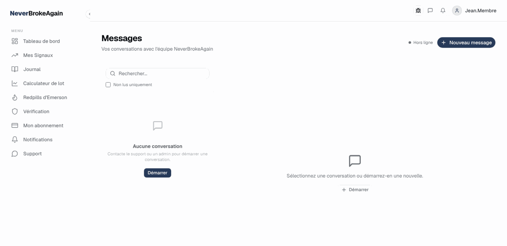

### 🟠 UX-18 (#336) — Formulaires (M+A)
- Calculateur de lot : placeholders `1.08500 / 1.08200` qui ressemblent à des valeurs saisies ; « Solde » et « Risque % » annoncés dans le sous-titre mais **cachés** tant que l'entrée/SL ne sont pas remplis.
- Messagerie groupée : **double case à cocher** « Tous les groupes », « 1 membres », textarea en police monospace pré-remplie d'un long texte marketing.
- Redpills admin : champs sans label (placeholder seul), icônes emoji (📝🖼️🎙️🎬) au lieu de Lucide, « Vidéo : champ prévu, bientôt » alors que la carte Vidéo est active.
- Audit : 3 selects et 2 dates sans label (axe `select-name`, `label`).
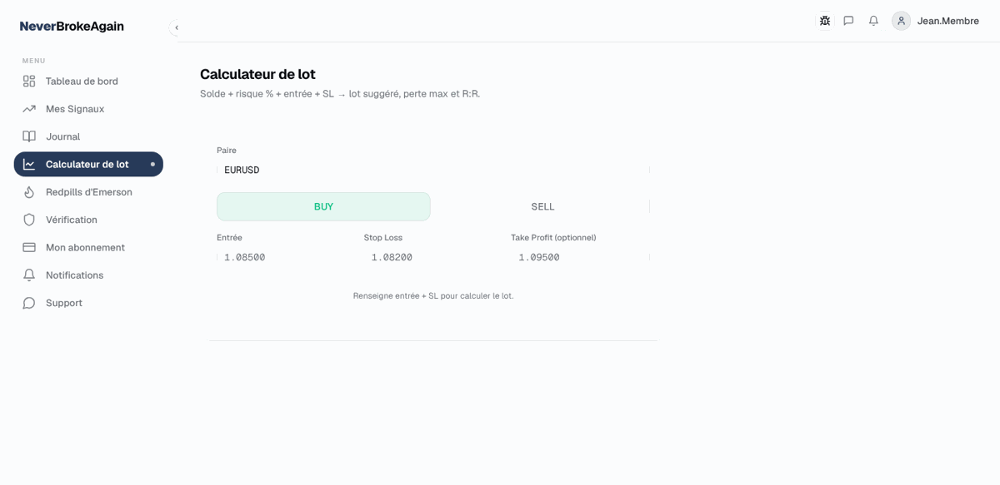
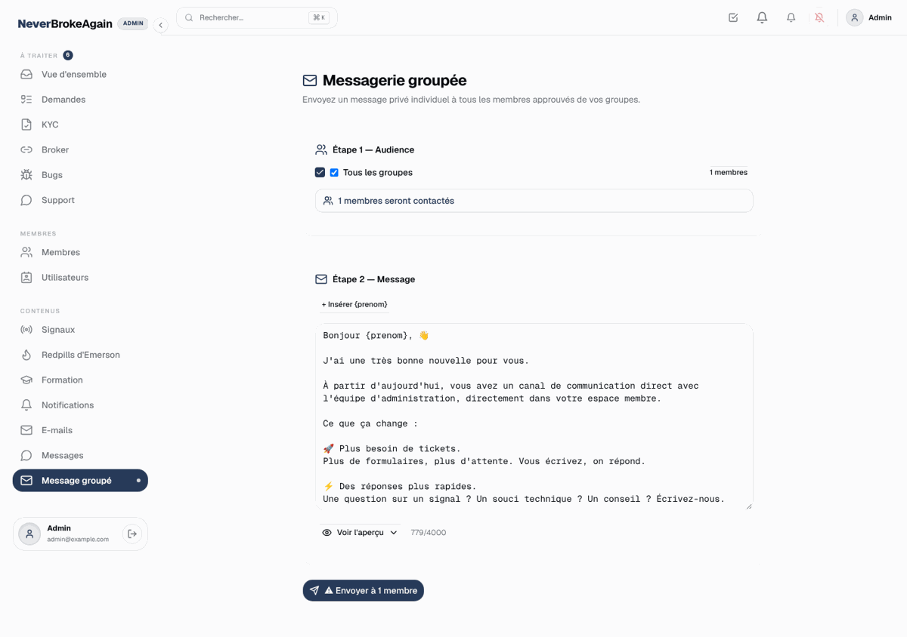

### 🟠 UX-19 (#337) — Accessibilité (WCAG 2.1 AA)
Résultats axe-core (extraits) :
| Règle | Où | Détail |
|---|---|---|
| `color-contrast` | sidebar admin (toutes pages) | titres de section `text-muted-foreground/50 text-[10px]` : **1.97:1** |
| `color-contrast` | Tracker admin | **65** nœuds en échec |
| `color-contrast` | badges `text-success` sur `bg-success/10` | 3.05–3.36:1 |
| `button-name` | Anti-fraude (bouton ▶ bleu, loupe), Audit (corbeille) | boutons icônes sans nom |
| `select-name` / `label` | Audit, Journal, Vérification, Demandes | 7 selects sans label sur Demandes |
| `aria-toggle-field-name` | Demandes (6 cases) | |
| `scrollable-region-focusable` | Dashboard, Cache, Anti-fraude | |
- **162** occurrences `text-[9px]/[10px]/[11px]` ; 130 éléments < 12 px sur le Tracker.
- Zones tactiles < 44 px : 50–90 par page admin desktop, jusqu'à 33 éléments < 24 px (Signaux admin mobile).
- Complète les issues existantes #284 (contraste) et #285 (clavier).

### 🟡 UX-20 (#338) — Confirmations natives et actions destructrices (A+M)
- `confirm()` natifs restants : `trade-card.tsx:59`, `batch-actions-bar.tsx:133`, `SmartSuggestions.tsx:116`, `ModerationTab.tsx:48`, `redpills/page.tsx:193` (alors que `useConfirm` existe).
- « Purger » (journal d'audit) rouge dans la barre d'export, « Suspendre » inline sans étape de confirmation visible, « Révoquer » sur sa propre session sans marqueur « (vous) ».

### 🟡 UX-21 (#339) — Écrans de traitement admin (Demandes, Membres)
- Barre « Progression onboarding » : piste quasi noire, remplissage navy → illisible ; 20 % pour tous les dossiers quel que soit le statut.
- Badge « OK » vert sans explication (e-mail ? paiement ?). Sur mobile, le select de plan et le badge « En attente » débordent de la carte.
- Membres : statut « Actif » vert pour des prospects `REGISTERED`/`PAYMENT_PENDING` ; actions techniques « Vider le cache », « Nettoyer accès fantômes » mélangées aux filtres ; colonne Actions coupée à 1 440 px.
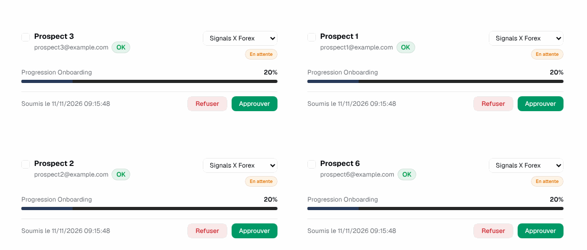

### 🟡 UX-22 (#340) — Écrans techniques (A)
- Mode développeur : « Uptime 0h » dans la carte, « 23 min » dans le détail ; Cache : `WEBSOCKET DOWN` en rouge sans explication ni action ; « 0 échec(s) ».
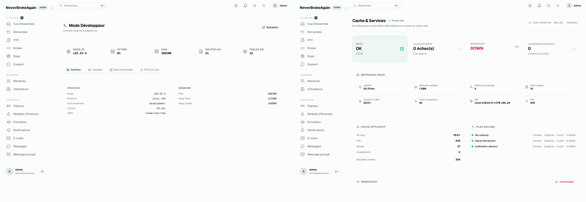

### 🟡 UX-23 (#341) — Tableau de bord membre (M)
- 4 actions rapides dont 2 doublonnent les cartes du dessous (« Voir les signaux », « Mon journal ») ; la carte « Signaux du jour » ne montre **aucun** signal alors qu'il y en a 8 nouveaux.
- Point blanc dans l'item actif de la sidebar (doublon d'indicateur).
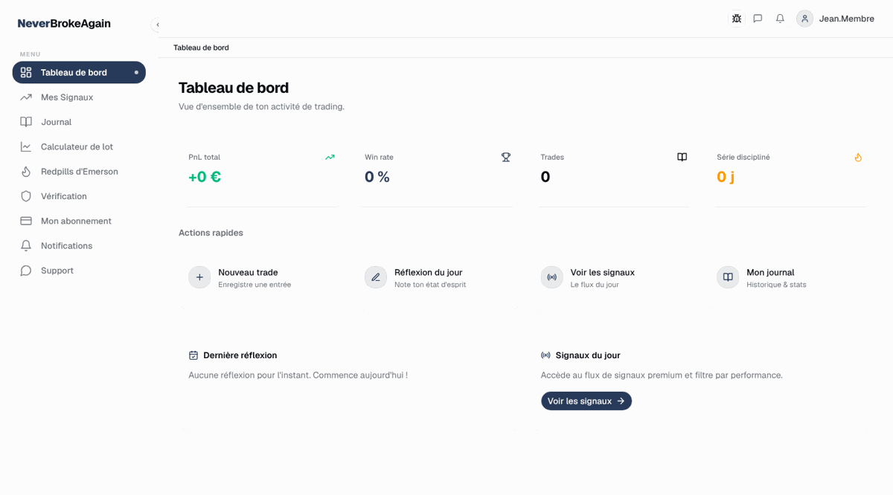

---

## 3. Hors périmètre UI mais relevé
- `prisma migrate deploy` échoue sur base vierge (`relation "trades" does not exist`) : un environnement neuf ne peut pas être monté avec les migrations.
- `CUsersPCAppDataLocalTempopencodevitest-output.txt` (77 Ko) et `temp_gen.py` committés à la racine.

## 4. Plan de correction proposé

| Sprint | Issues | Effort |
|---|---|---|
| **S1 — bugs bloquants** | UX-01, 02, 03, 04, 05, 06 | ~3 j |
| **S2 — navigation** | UX-07, 08, 09, 10 | ~3 j |
| **S3 — contenu & cohérence** | UX-11, 12, 13, 16, 17 | ~4 j |
| **S4 — composants & a11y** | UX-14, 15, 18, 19, 20, 21, 22, 23 | ~5 j |
